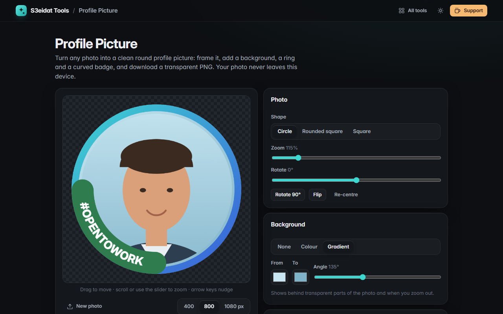

# Profile Picture

> Round profile pictures with rings and badges. Free, private, and it runs entirely in your browser.

### ▶ [Open Profile Picture](https://s3eidat.github.io/profile-pic/)



## Features

- Load a photo by dropping, pasting (<kbd>Ctrl</kbd>+<kbd>V</kbd>) or choosing a file
- **Frame it**: drag to move, scroll or slider to zoom (50–500%), rotate any angle or by 90°, flip, arrow keys to nudge
- **Shape**: circle, rounded square or square
- **Background** colour or gradient behind transparent photos and when you zoom out
- **Ring border** with width, gap, solid colour or gradient, plus presets
- **Curved text badge** ("#OPENTOWORK" style) at the bottom left, bottom or top, with your own colours; Arabic text keeps its letter shapes on the curve
- **Export PNG** at 400, 800 or 1080 px with transparent corners, or copy it to the clipboard

## Privacy

Your photo never leaves your device: it is drawn on a canvas in your browser. Settings (not photos) are remembered in local storage.
There is no server, no account, no analytics. The page ships with a strict Content-Security-Policy
(`connect-src 'self'`), so the browser itself blocks any attempt to send data anywhere.

## Run it yourself

It's plain HTML, CSS and JavaScript with no build step:

```bash
git clone https://github.com/s3eidat/profile-pic
cd profile-pic
python -m http.server 8000
```

Then open http://localhost:8000.

## Support

If this saved you time, **[buy me a coffee ☕](https://s3eidat.github.io/coffee/)**. It keeps every tool free.

---

Part of **[S3eidat Tools](https://s3eidat.github.io/)**: 100+ free, private tools that run in your browser. MIT licensed.
